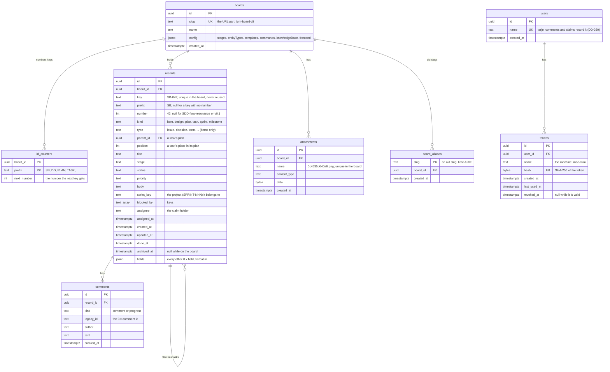

# Data model

The Postgres model for pm 1.x. It holds every repo's board in one database (DD-001, DD-002 on
the pm-board-cli board). The decisions behind this shape are DD-010 to DD-015. This file holds
only the shape and the mapping from 0.x.

Two words (DD-015): a **board** is everything pm holds for one repo, at `/<slug>`. A **project**
is what it is in 0.x, a SPRINT-NNN record inside a board.

Users and tokens are not per board: a token writes to every board (DD-003, DD-020).

## Rules

- **A key is unique in its board across every kind.** One unique index, `(board_id, key)` on
  `records`, covers items, designs, plans, tasks, sprints and milestones, live and archived. 0.x
  already treated them as one id space (`allIdPools` in `lib/store.js`).
- **A new key comes from `id_counters`, never from `max + 1`.** The allocation is one statement,
  `INSERT ... ON CONFLICT (board_id, prefix) DO UPDATE SET next_number = next_number + 1
  RETURNING`, in the same transaction as the insert of the record. The row lock makes a second
  writer for the same prefix wait. If the insert fails, the transaction rolls back and the number
  is not used, so keys have no gaps from failures.
- **Keys are formatted** as `PREFIX-NNN`, with at least three digits: `SB-007`, `SB-042`,
  `SB-1000`. That is the 0.x format.
- **References are keys, not foreign keys.** `blocked_by`, `sprint_key` and the reference fields
  in `fields` (`related`, `itemIds`, `sddId`) hold keys, the same as in 0.x. The imported boards
  have references to keys that no longer exist, and a foreign key would refuse them. The importer
  reports them. Only `parent_id` (task to plan) and `comments.record_id` are foreign keys, with
  `ON DELETE RESTRICT`.
- **Archiving sets `archived_at`.** The record keeps its key, so the key is never reused.
- **Comments are rows, not a JSON array.** Two writers who add a comment at the same moment then
  both succeed. A task's `progressNotes` are comments of kind `progress`.
- **A write is one transaction, and locks what it changes.** Each write route reads the records it
  changes with `FOR UPDATE` first. Two claims of one item take turns, so exactly one wins, and two
  comments on one record get positions one after the other. A refused write (any 4xx) rolls back,
  so its key numbers go back to the counter.
- **A body write never loses text (DD-030).** PATCH on an item, a design or a project takes
  `bodyPrepend` and `bodyAppend`, which add a block in the update's transaction, with one blank line
  between it and the body (on a blank body, the text alone). `body` replaces the whole body. On a
  body with text, `body` needs `bodyBase`, the `bodyHash` of the body it replaces, or
  `force: true`. `bodyHash` is the first 12 hex characters of the sha256 of the body as UTF-8
  (`Boards/BodyGuard.cs`). The route locks the row before it hashes, so of two replaces with one
  base, one wins and the other gets 409 `{error, bodyHash}` with the current hash. A missing base
  is 409 too. `body` with `bodyPrepend` or `bodyAppend` is 400. A blank body needs no base.
  `bodyBase` is compared without case. A `bodyBase` that is not 12 hex characters is 400.
- **A key given by hand moves the counter past it.** A plan's task list in PATCH may hold a key
  that is not taken yet. The counter then never gives that number out (DD-016).
- **Only a token's hash is stored.** A token is `pmb_` and 32 random bytes, so SHA-256 is enough:
  it is not a password. A revoked token keeps its row, for `token list`. A user's tokens that are
  not revoked have different names (a unique index with `WHERE revoked_at IS NULL`).
- **A board can be renamed, and its old slug stays an alias (DD-035).** `PATCH /api/boards/{slug}`
  takes `slug`, `name` or both, with a token; any other field is 400 (DD-016). The new slug follows
  the rules of `POST /api/boards`. A new slug moves the old one to `board_aliases`. A slug that
  another board has, as its slug or an alias, is 409. A rename back to one of the board's own
  aliases removes that alias. A new board, or an import, cannot take an alias. Keys, bodies and
  links inside the board do not change.
- **An alias resolves in one place** (`Boards/BoardAliases.cs`), a middleware before routing. A path
  under `/api/boards/<alias>` (in any case) is rewritten to the board's slug, so every read and
  write route acts on the board, and the answer has `X-Pm-Board: <slug>`. Every request under
  `/api/boards/<slug>/` makes this one alias lookup, by primary key. A GET or HEAD of a dashboard
  path `/<alias>/...` is a 302 to `/<slug>/...`, with the path escaped again and the query kept.
  `/api/boards` lists boards only. `pm` prints one hint line on stderr when an answer has the
  header.
- **One advisory lock guards every slug.** No unique index spans `boards.slug` and
  `board_aliases.slug`, so create, rename and import take `pg_advisory_xact_lock` in their
  transaction and check the slug after it. Without it, two writes for one slug both see it free,
  and the loser fails on the unique index with a 500.
- **The export does not resolve aliases and writes none:** 0.x has no aliases. `export --board`
  takes a board's slug, not an alias.
- **Attachments are rows** (DD-018), and a board's own prompt templates are in `boards.config` as
  `templateFiles` (DD-017).

## From 0.x

The importer reads each 0.x data dir with the 0.x store itself (`tools/export-v0.mjs`), so a file
that 0.x skips is skipped the same way. A column holds a field when every kind uses it the same
way. Every other field goes into `fields` with its 0.x name and value, so nothing is lost.

| 0.x | records.kind | Columns | Into `fields` |
|---|---|---|---|
| `items/*.md` | `item` | id, type, title, stage, status, priority, body, sprintId, blockedBy, assignee, assignedAt, createdAt, updatedAt, doneAt | pillar, related, affectedFiles, aliases, and rare ones: section, source, seeds, firstSeen, fixed, frequency, triageAction, triageNote |
| `archive/*.md` (not SDD) | `item` | the same, plus archivedAt | the same |
| `designs/*.md`, `archive/SDD-*.md` | `design` | id, title, stage, status, body, sprintId, createdAt, updatedAt, archivedAt | itemIds, schema, tests |
| `plans/*.json` | `plan` | id, title, stage, sprintId, createdAt, updatedAt | sddId, context |
| a plan's `tasks[]` | `task` | id, title, status, blockedBy; `parent_id` and `position` from the plan | description, steps, verification, passes |
| `sprints/*.json` | `sprint` | id, name as title, status, body, createdAt | problemStatement, completedAt |
| `milestones/*.json` | `milestone` | id, title, status | shippedDate, phases |
| `comments[]` | comments, `kind = comment` | id as legacy_id, author, text, createdAt | |
| a task's `progressNotes[]` | comments, `kind = progress` | text, timestamp as created_at | |
| `pm.config.json` | boards.config | stages, entityTypes, commands, knowledgeBase, templates, frontend | |

Not imported: `meta.json` (its counters are replaced by `id_counters`), `port`, `dataDir`,
`autoCommit` and `autoSync` from the config, and the `*.tests.json` files next to items and
designs, which the 0.x store never reads either.

After an import, each `id_counters` row is one more than the highest number with that prefix in
the board, counting live, archived and skipped records.

### What the importer reports

- **Clashes**: two records with one key. Live records are read before archived ones, and plans in
  file order. If both copies are the same record (same kind, title and body, for example archived
  and then put back), only the first is kept. If they are different records, both are kept: the
  second gets the next free number, and its 0.x key stays in `fields.v0Key`. 0.x resolves a task's
  `blockedBy` among the tasks of its own plan, so in the plan of a renumbered task, the other tasks'
  `blockedBy` follow it to the new key. The report has the
  second copy in full either way. On the boards of 21 Nov 2026 this kept five tasks in
  lifelines-core-loop that had the same key as a task in another plan (TASK-212, TASK-711 to
  TASK-714), and one archived term in healthy-humans-godot (TERM-053, "Barrier").
- **Skipped files**: files that 0.x itself skips (a file whose name does not match its id, or that
  does not parse). Their number still counts for the counter, as in 0.x.
- **Dangling references**: keys in `blocked_by`, `sprint_key`, `related`, `itemIds` or `sddId`
  that match no record. Most of them are older tasks whose `blockedBy` holds a label ("Task 2",
  "Task 3: Add CameraRig ...") in place of a key. They are kept as they are.

### How the write API keeps 0.x's shapes

The write routes port the 0.x handlers line by line, with JavaScript's rules for what is truthy and
what a value prints as (`Boards/Js.cs`). A few 0.x behaviours come from its files, not its code,
and 1.x copies them:

- Items and designs are markdown files in 0.x, and a blank body is not in the file. So a read gives
  no `body` for a blank one, while the answer to the create or patch that set it has `body: ""`, as
  0.x held it in memory. Plans and projects are JSON files and keep `""`.
- A project (sprint) has no `updatedAt`. Completing one closes its open items with `doneAt` but no
  `updatedAt`, and adding items to it leaves their `updatedAt` as it was.
- Lists that build text (explore, suggest, prompt, review) take records in key order, the order of
  0.x's sorted file names.

What 1.x does differently on purpose is in DD-016 to DD-019, and DD-030 (the body guard).

### Known differences from 0.x output

- Postgres `jsonb` does not keep the order of keys in `fields`, and a typed column cannot tell a
  missing field from `null`. The 1.x API writes fields in a fixed order. The golden tests in
  PLAN-001 Task 6 compare `--json` output as data, not as text.

## Back to 0.x files (the export)

`PmBoard.Api export` reads the mapping above the other way (DD-022). Each record becomes its V0Json
shape, the same JSON the read API answers, and goes where 0.x keeps it: a live item or design to
`data/items` or `data/designs` as markdown, a plan, project or milestone to its folder as JSON,
an archived record to `data/archive`. A `tests` field goes to its `*.tests.json` sidecar. The
board's config becomes `pm.config.json`, with `dataDir: "data"`, and `templateFiles` becomes a
`templates` folder.

Frontmatter is block-style YAML with every string in JSON quotes. YAML 1.2 reads a JSON-quoted
string as the same string, so no title such as `null`, `yes` or `key: value` changes type. Keys
follow V0Json's order, so the first export of a board can order keys unlike its 0.x files.
