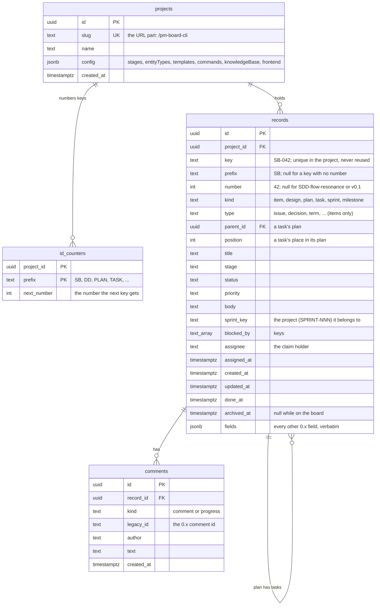

# Data model

The Postgres model for pm 1.x. It holds every project's board in one database (DD-001, DD-002 on
the pm-board-cli board). The decisions behind this shape are DD-010 to DD-014. This file holds
only the shape and the mapping from 0.x.

Users and API tokens (DD-003) come with the write API in PLAN-001 Task 6, in their own migration.

## Rules

- **A key is unique in its project across every kind.** One unique index, `(project_id, key)` on
  `records`, covers items, designs, plans, tasks, sprints and milestones, live and archived. 0.x
  already treated them as one id space (`allIdPools` in `lib/store.js`).
- **A new key comes from `id_counters`, never from `max + 1`.** The allocation is one statement,
  `INSERT ... ON CONFLICT (project_id, prefix) DO UPDATE SET next_number = next_number + 1
  RETURNING`, in the same transaction as the insert of the record. The row lock makes a second
  writer for the same prefix wait. If the insert fails, the transaction rolls back and the number
  is not used, so keys have no gaps from failures.
- **Keys are formatted** as `PREFIX-NNN`, with at least three digits: `SB-007`, `SB-042`,
  `SB-1000`. That is the 0.x format.
- **References are keys, not foreign keys.** `blocked_by`, `sprint_key` and the reference fields
  in `fields` (`related`, `itemIds`, `sddId`) hold keys, the same as in 0.x. The imported boards
  have references to keys that no longer exist, and a foreign key would refuse them. The importer
  reports them. Only `parent_id` (task to plan) and `comments.record_id` are foreign keys, with
  `ON DELETE RESTRICT`.
- **Archiving sets `archived_at`.** The record keeps its key, so the key is never reused.
- **Comments are rows, not a JSON array.** Two writers who add a comment at the same moment then
  both succeed. A task's `progressNotes` are comments of kind `progress`.

## From 0.x

The importer reads each 0.x data dir with the 0.x store itself (`tools/export-v0.mjs`), so a file
that 0.x skips is skipped the same way. A column holds a field when every kind uses it the same
way. Every other field goes into `fields` with its 0.x name and value, so nothing is lost.

| 0.x | records.kind | Columns | Into `fields` |
|---|---|---|---|
| `items/*.md` | `item` | id, type, title, stage, status, priority, body, sprintId, blockedBy, assignee, assignedAt, createdAt, updatedAt, doneAt | pillar, related, affectedFiles, aliases, and rare ones: section, source, seeds, firstSeen, fixed, frequency, triageAction, triageNote |
| `archive/*.md` (not SDD) | `item` | the same, plus archivedAt | the same |
| `designs/*.md`, `archive/SDD-*.md` | `design` | id, title, stage, status, body, sprintId, createdAt, updatedAt, archivedAt | itemIds, schema, tests |
| `plans/*.json` | `plan` | id, title, stage, sprintId, createdAt, updatedAt | sddId, context |
| a plan's `tasks[]` | `task` | id, title, status, blockedBy; `parent_id` and `position` from the plan | description, steps, verification, passes |
| `sprints/*.json` | `sprint` | id, name as title, status, body, createdAt | problemStatement, completedAt |
| `milestones/*.json` | `milestone` | id, title, status | shippedDate, phases |
| `comments[]` | comments, `kind = comment` | id as legacy_id, author, text, createdAt | |
| a task's `progressNotes[]` | comments, `kind = progress` | text, timestamp as created_at | |
| `pm.config.json` | projects.config | stages, entityTypes, commands, knowledgeBase, templates, frontend | |

Not imported: `meta.json` (its counters are replaced by `id_counters`), `port`, `dataDir`,
`autoCommit` and `autoSync` from the config, and the `*.tests.json` files next to items and
designs, which the 0.x store never reads either.

After an import, each `id_counters` row is one more than the highest number with that prefix in
the project, counting live, archived and skipped records.

### What the importer reports

- **Clashes**: two records with one key. Live records are read before archived ones, and plans in
  file order. If both copies are the same record (same kind, title and body, for example archived
  and then put back), only the first is kept. If they are different records, both are kept: the
  second gets the next free number, and its 0.x key stays in `fields.v0Key`. The report has the
  second copy in full either way. On the boards of 21 Nov 2026 this kept five tasks in
  lifelines-core-loop that had the same key as a task in another plan (TASK-212, TASK-711 to
  TASK-714), and one archived term in healthy-humans-godot (TERM-053, "Barrier").
- **Skipped files**: files that 0.x itself skips (a file whose name does not match its id, or that
  does not parse). Their number still counts for the counter, as in 0.x.
- **Dangling references**: keys in `blocked_by`, `sprint_key`, `related`, `itemIds` or `sddId`
  that match no record. Most of them are older tasks whose `blockedBy` holds a label ("Task 2",
  "Task 3: Add CameraRig ...") in place of a key. They are kept as they are.

### Known differences from 0.x output

- Postgres `jsonb` does not keep the order of keys in `fields`, and a typed column cannot tell a
  missing field from `null`. The 1.x API writes fields in a fixed order. The golden tests in
  PLAN-001 Task 6 compare `--json` output as data, not as text.
